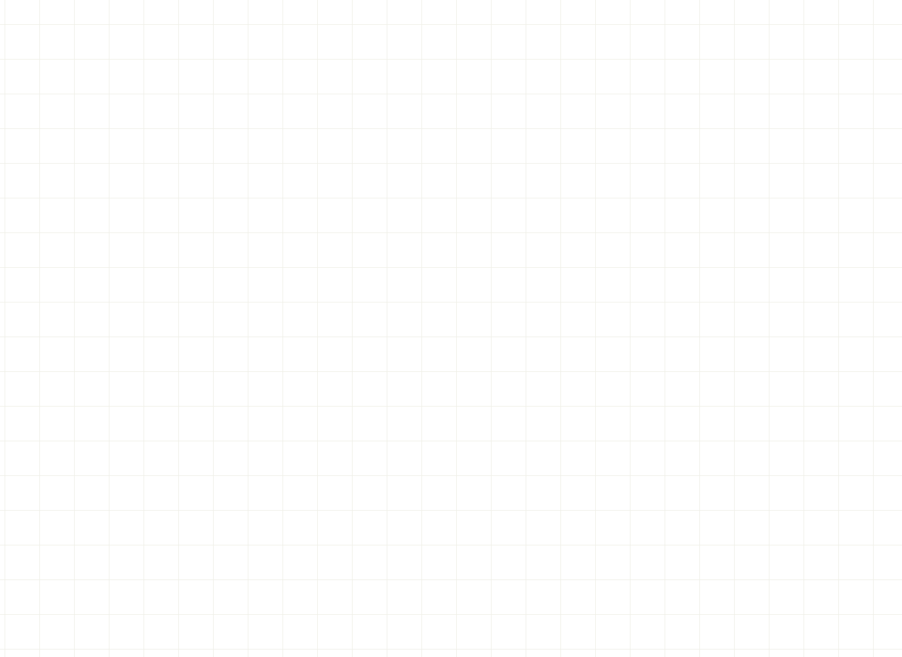
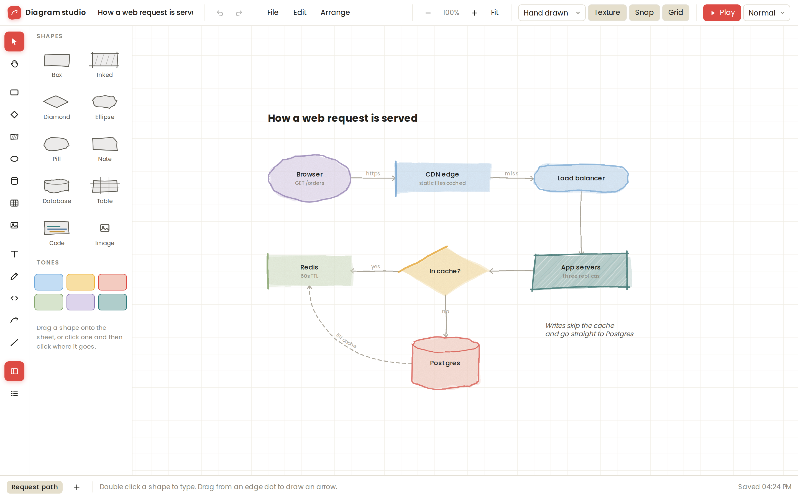

# Diagram studio

A hand-drawn diagram editor that lives in a single HTML file. Sketch boxes, arrows, tables and code, then press **Play** to reveal the diagram piece by piece, following the arrows.



**[Try it in your browser](https://angelicalastra.github.io/diagram-ui/)**, or download [`diagram-studio.html`](diagram-studio.html) and double-click it. There's nothing to install and no build step.



## What it does

**Drawing**
- Boxes, inked boxes, diamonds, ellipses, pills, notes, databases, tables, code blocks, images and freehand pen strokes.
- Arrows and lines that stay attached as you move shapes, can tie to a single table row, or float free. Curved, straight or elbow, with labels.
- Text that keeps its spacing and indents, with bold, italic, underline, strikethrough and inline code on individual words.
- Tables with merged cells, resizable columns, per-cell colours, and spreadsheet-style copy and paste.
- Code blocks with SQL, Jinja and YAML highlighting.
- Four levels of roughness, from clean edges to very loose, plus paper grain you can switch off.

**Organising**
- Group and ungroup, bring to front and send to back, duplicate, and a format painter for copying one item's look onto others.
- An infinite canvas with snapping, a grid, and several sheets per file.

**Presenting**
- **Play** reveals the diagram in the order the arrows flow. The reveal order can be rearranged by hand, with pauses and steps that hide things as well as show them.
- Arrows can animate a flow along their path.

**Exporting**
- PNG (1x to 3x), SVG, an animated or still GIF of the reveal, an MP4 video, or a standalone web page.
- Any export can cover just the selected items.

## Examples

The [`examples/`](examples) folder has a few diagrams to open with **File --> Open a file**:

| File | Shows off |
| --- | --- |
| [`web-request.json`](examples/web-request.json) | Shapes, a database, a decision, arrow labels and the reveal |
| [`data-model.json`](examples/data-model.json) | Tables with arrows tied to individual rows |
| [`release-flow.json`](examples/release-flow.json) | A YAML code block, a dashed retry loop and an outline-only box |

**File --> Load the sample** also brings back the built-in pipeline diagram.

## Keyboard shortcuts

Press `?` in the app for the full list. The ones you'll reach for most:

| Keys | Does |
| --- | --- |
| `V` `H` | Select, pan |
| `B` `D` `S` `E` | Box, diamond, inked box, ellipse |
| `Y` `G` `K` | Database, table, code block |
| `T` | Text (or double-click the sheet) |
| `C` `L` | Arrow, line |
| `P` | Pen |
| `Ctrl` + `G` / `Ctrl` + `Shift` + `G` | Group, ungroup |
| `Ctrl` + `D` | Duplicate |
| `Ctrl` + `Alt` + `C` / `V` | Copy a style, paste it onto the selection |
| `Ctrl` + `Z` / `Ctrl` + `Shift` + `Z` | Undo, redo |
| `Space` + drag, or right-drag | Pan |
| `Ctrl` + scroll | Zoom at the pointer |

On a Mac, use `Cmd` in place of `Ctrl`.

## Where your diagrams are saved

Everything stays in your browser. The current diagram is saved to local storage as you work, and nothing is uploaded anywhere. Use **File --> Save a copy** (`Ctrl` + `S`) to download it as a `.json` file, and **File --> Open a file** to load one back.

Browsers keep local storage separate for each address, so the hosted version and a copy you open from your own disk don't share saved work. Move a diagram between them by saving and opening the `.json`.

## How it's built

The app is plain HTML, CSS and JavaScript with no dependencies beyond the Poppins font from Google Fonts. The source is split up in [`src/`](src) so it's easier to find your way around, and [`build.js`](build.js) stitches it back into the single [`diagram-studio.html`](diagram-studio.html) that people open:

```
src/
  shell.html        <-- the page markup, with markers for the two parts below
  styles.css
  js/
    01-constants.js
    02-document.js  <-- the diagram model, undo and saving
    ...
    18-app.js       <-- modals, top bar, keyboard, startup
build.js            <-- node build.js (or --check to spot a stale build)
```

The JavaScript files are laid end to end inside one function, in name order, so they share one scope and need no imports. The built file is committed, which keeps double-clicking it and the hosted copy working with no build step.

## Licence

Copyright (c) 2026 Angelica Lastra. All rights reserved. You are welcome to use the hosted app, but the code is not licensed for reuse.
